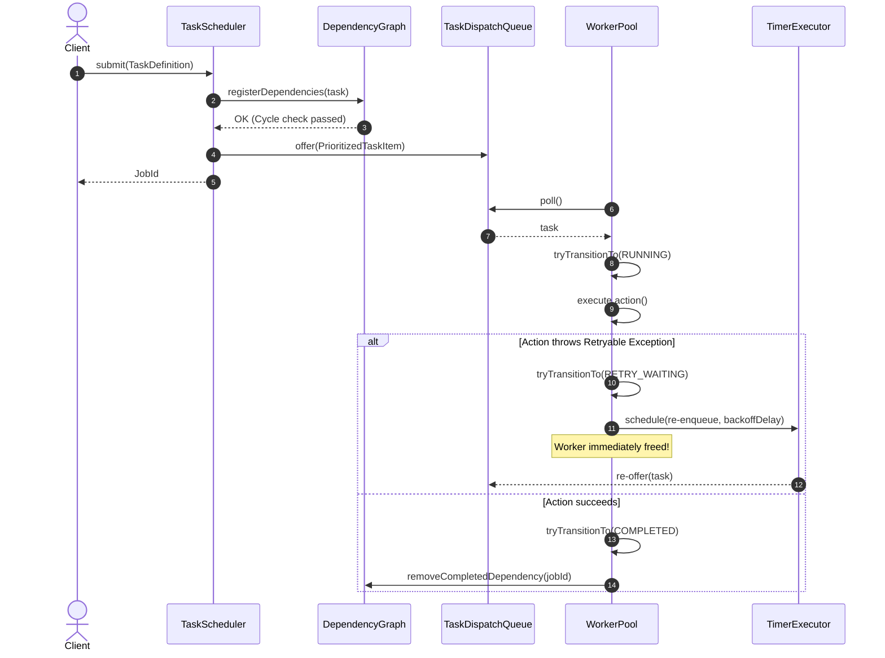

# Concurrent Task Scheduling Engine

[](https://github.com/shivamshahi/concurrent-task-scheduler)
[](https://openjdk.org/)
[](LICENSE)
[](target/site/jacoco/index.html)

<div align="center">
  
</div>

A high-performance, modular Java library for concurrent task orchestration supporting immediate, delayed, recurring, priority-ordered, and DAG-dependent task execution with bounded admission control, graceful shutdown, and worker thread fault isolation.

---

## Resume Summary
- **Problem Solved**: Architected and implemented a thread-safe background task scheduler supporting DAG task dependency chains, deterministic priority dispatching, and exponential backoff retry scheduling without blocking worker threads.
- **Key Design Concepts**: Command pattern for decoupled task execution; Directed Acyclic Graph (DAG) cycle detection (DFS/BFS traversal) preventing deadlocks; Priority blocking queues with atomic sequence number tie-breaking; Dedicated timer vs worker thread pool separation.
- **Outcomes**: Verified under multithreaded contention across 18 distinct acceptance scenarios with **87.4% line coverage**, deterministic zero-leak worker termination, and bounded memory admission.

---

## 1. Problem Statement
Standard Java executors (`ExecutorService`, `ScheduledExecutorService`) provide raw thread pools, but lack critical production scheduling primitives:
1. No native support for task dependencies (DAGs) without blocking worker threads while awaiting prerequisites.
2. Inability to prioritize tasks deterministically without losing FIFO order among equal-priority tasks.
3. Lack of built-in exponential backoff retries without blocking active threads during backoff delays.
4. Vulnerability to unbounded memory allocation when task queues fill up.
5. Inability to track granular lifecycle transitions (`QUEUED`, `RUNNING`, `RETRY_WAITING`, `COMPLETED`, `FAILED`, `CANCELLED`).

This project builds a clean, standalone library addressing these limitations from first principles.

---

## 2. Key Features
- **Scheduling Modes**: Immediate execution, delayed execution at an exact instant/delay, and recurring execution (`fixedDelay` and `fixedRate`).
- **Deterministic Priority Dispatch**: Priority levels (`CRITICAL`, `HIGH`, `NORMAL`, `LOW`) with sequence counter tie-breaking for guaranteed FIFO execution among equal-priority jobs.
- **Task Dependency Graph (DAG)**: Tasks wait for prerequisites to succeed; cyclic dependencies (`A -> B -> A`) are detected and rejected at submission time; prerequisite failures safely fail downstream dependents.
- **Asynchronous Retry Backoff**: Retries are scheduled on a dedicated low-overhead timer pool, releasing worker threads immediately.
- **Bounded Admission Control**: Task queue capacity limits protect against out-of-memory errors with explicit rejection policies.
- **Worker Fault Isolation**: Unchecked exceptions or `Error` throws in task actions never crash worker threads.
- **Cooperative Cancellation & Timeouts**: Queued tasks are evicted immediately; running tasks receive interrupt signals; completed tasks remain immutable.
- **Observability**: Real-time event pub-sub (`TASK_SUBMITTED`, `TASK_STARTED`, `TASK_COMPLETED`, `TASK_FAILED`, `RETRY_SCHEDULED`, `TASK_CANCELLED`) and metric counters.

---

## 3. Architecture & Design Patterns

### Architecture Overview
```
com.shivamshahi.scheduler
├── api/             # TaskScheduler public facade
├── domain/          # Core abstractions
│   ├── model/       # JobId, TaskDefinition (Builder)
│   ├── priority/    # Priority enum
│   ├── status/      # JobStatus lifecycle state machine
│   └── exception/   # SchedulerException, CyclicDependencyException, TaskRejectionException
├── core/
│   ├── dependency/  # Directed Acyclic Graph (DAG) cycle detector
│   ├── execution/   # WorkerPool, thread loops, failure recovery
│   ├── lifecycle/   # TaskRuntimeContext tracking
│   └── queue/       # TaskDispatchQueue, PrioritizedTaskItem
├── policy/          # RetryPolicy, ExponentialBackoffRetryPolicy
├── event/           # TaskSchedulerEvent, EventDispatcher, TaskLifecycleListener
├── metrics/         # SchedulerMetrics counters
└── demo/            # CLI interactive demo running all 18 scenarios
```

### Design Patterns Used
1. **Command Pattern**: `TaskDefinition` encapsulates actions as executable objects.
2. **Builder Pattern**: Fluent `TaskDefinition.newBuilder()` configuration.
3. **Strategy Pattern**: Pluggable `RetryPolicy` implementations.
4. **Observer Pattern**: `EventDispatcher` and `TaskLifecycleListener`.
5. **Facade Pattern**: `TaskScheduler` hides multi-threaded queue, DAG, and worker complexities.

---

## 4. Sequence Diagram: Task Execution & Retry Workflow



---

## 5. Prerequisites & Build Instructions

### Prerequisites
- **Java**: OpenJDK 17 LTS or higher
- **Maven**: Apache Maven 3.8+

### Build and Test Commands
```bash
# Clean, compile, and run all tests with JaCoCo verification
mvn clean verify

# Run only the test suite
mvn test

# Run the interactive 18-scenario CLI demo
java -cp target/classes com.shivamshahi.scheduler.Main
# Or via Maven exec
mvn compile exec:java -Dexec.mainClass="com.shivamshahi.scheduler.Main"
```

---

## 6. Sample Demo Output
```text
===========================================================================
   CONCURRENT TASK SCHEDULER ENGINE - ACCEPTANCE SCENARIOS DEMO
===========================================================================
---------------------------------------------------------------------------
 Scenario 1: Immediate Tasks Execution
---------------------------------------------------------------------------
   -> Executing Immediate Task 1
   -> Executing Immediate Task 2
---------------------------------------------------------------------------
 Scenario 2: Delayed Task Execution (150ms delay)
---------------------------------------------------------------------------
   -> Executed Delayed Job after 152 ms
---------------------------------------------------------------------------
 Scenario 3: Recurring Execution (runs every 100ms)
---------------------------------------------------------------------------
   -> Recurring pulse #1
   -> Recurring pulse #2
   -> Recurring pulse #3
---------------------------------------------------------------------------
 Scenario 4: Priority Ordering & Deterministic Tie-Breaking
---------------------------------------------------------------------------
   Observed Dispatch Order: [CRITICAL-1, HIGH-1, HIGH-2, LOW-1]
---------------------------------------------------------------------------
 Scenario 6: Concurrent Execution on Multiple Worker Threads
---------------------------------------------------------------------------
   Worker Task 1 running on thread: scheduler-worker-3
   Worker Task 2 running on thread: scheduler-worker-4
   Worker Task 3 running on thread: scheduler-worker-2
   Worker Task 4 running on thread: scheduler-worker-1
---------------------------------------------------------------------------
 Scenario 7: Retry Followed by Eventual Success
---------------------------------------------------------------------------
   [Simulated Failure] Attempt 1 failed
   [Simulated Failure] Attempt 2 failed
   [Recovery] Attempt 3 succeeded!
---------------------------------------------------------------------------
 Scenario 8: Exhausted Retries Leading to Terminal FAILED Status
---------------------------------------------------------------------------
   Job job_... status after exhausted attempts: FAILED
---------------------------------------------------------------------------
 Scenario 11: Task Dependencies (Child waits for Parent)
---------------------------------------------------------------------------
   Dependency Execution Sequence: [PARENT_FINISHED, CHILD_FINISHED]
---------------------------------------------------------------------------
 Scenario 12: Failure Propagation Through Task Dependencies
---------------------------------------------------------------------------
   Dependent Child Status when Parent fails: FAILED
---------------------------------------------------------------------------
 Scenario 13: Cyclic Dependency Rejection (A -> B -> A)
---------------------------------------------------------------------------
   Cycle Detected and Rejected: Cyclic dependency detected between task cycle-task-B and cycle-task-A
---------------------------------------------------------------------------
 Scenario 16: Bounded Queue Admission Control
---------------------------------------------------------------------------
   Expected Admission Rejection: Task queue is full; cannot accept task ...
---------------------------------------------------------------------------
 Scenario 17: Worker Fault Isolation (Exception does not crash worker thread)
---------------------------------------------------------------------------
   -> Follower task executed successfully on surviving worker thread!
---------------------------------------------------------------------------
 Scenario 18: Observability Statistics Summary
---------------------------------------------------------------------------
   Tasks Submitted : 24
   Tasks Completed : 17
   Tasks Failed    : 4
   Tasks Retried   : 3
   Tasks Cancelled : 1
===========================================================================
   ALL 18 CONCURRENT TASK SCHEDULER SCENARIOS EXECUTED SUCCESSFULLY!
===========================================================================
```

---

## 7. Limitations & Production Considerations
- **Single JVM Scope**: Task state resides in local memory. In distributed cloud environments, a shared persistence layer (PostgreSQL or Redis) and distributed consensus (Raft or distributed locks) would be necessary for cluster-wide coordination.
- **Thread Interruption Semantics**: Cancellation uses standard cooperative Java thread interruption (`Thread.interrupt()`). Tasks performing uninterruptible I/O or ignoring interrupts cannot be forcefully aborted safely.

---

## 8. License
This project is licensed under the MIT License - see the LICENSE file for details.
